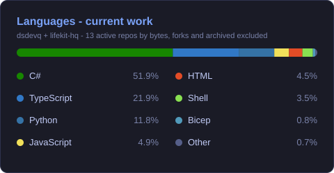
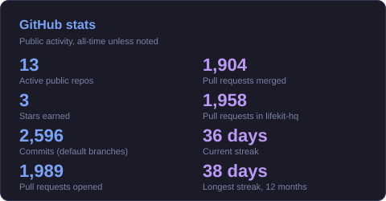
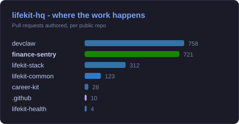
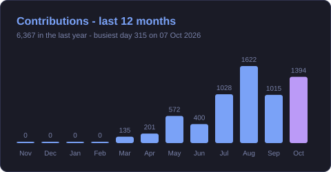

<!-- Banner -->


<p align="center">
  <a href="https://github.com/lifekit-hq"></a>
  <a href="https://github.com/lifekit-hq/finance-sentry"></a>
  <a href="https://www.linkedin.com/in/denys-sychov-4b2819242/"></a>
  <a href="https://leetcode.com/dsdevq"></a>
  <a href="https://gitlab.com/dsdevq"></a>
  
</p>

Full-stack developer in Dublin, Ireland 🇮🇪 with a strong core in **Angular + ASP.NET Core**. Outside work I build **AI agents and autonomous-development tooling**, in the open, in the [lifekit-hq](https://github.com/lifekit-hq) organization.

---

### 🚀 Featured: lifekit-hq and finance-sentry

<table>
  <tr>
    <td width="50%" valign="top">
      <h4><a href="https://github.com/lifekit-hq">lifekit-hq</a></h4>
      <p>A <b>self-hosted personal-AI stack</b>, built as a federation of independently shippable repositories: each product has its own repo, image, database, CI and releases, a platform repo deploys everything to one VPS, and a shared library carries the design system.</p>
      <p><a href="https://github.com/lifekit-hq">github.com/lifekit-hq</a></p>
    </td>
    <td width="50%" valign="top">
      <h4><a href="https://github.com/lifekit-hq/finance-sentry">finance-sentry</a></h4>
      <p>A <b>personal finance platform</b>: bank accounts, crypto and brokerage, budgets, subscriptions and alerts in one place. ASP.NET Core 9 (modular CQRS), Angular 21 and PostgreSQL; syncs TrueLayer, Monobank, Binance, Revolut X, Interactive Brokers and Inzhur; stored credentials are AES-256-GCM encrypted; versioned releases and an MCP interface for agents.</p>
      <p><a href="https://github.com/lifekit-hq/finance-sentry">github.com/lifekit-hq/finance-sentry</a></p>
    </td>
  </tr>
</table>

| Repo | What it is |
|---|---|
| [devclaw](https://github.com/lifekit-hq/devclaw) | An autonomous development loop behind MCP: a GitHub issue with a `## Done when` section goes in, a CI-checked pull request comes out (Python, Claude Code in a Docker sandbox) |
| [lifekit-stack](https://github.com/lifekit-hq/lifekit-stack) | Deploys the stack to a VPS: Docker Compose, with Prometheus, Loki, Tempo and Grafana for observability |
| [lifekit-health](https://github.com/lifekit-hq/lifekit-health) | Local-first CLI tools and agent skills for workout, nutrition and daily-state tracking (TypeScript) |
| [career-kit](https://github.com/lifekit-hq/career-kit) | YAML-driven CV tailoring over RenderCV: one profile of facts, many role variants (Python) |
| [lifekit-common](https://github.com/lifekit-hq/lifekit-common) | The lifekit design system: shared tokens and Angular components |

Most pull requests across lifekit-hq are opened by coding agents (Claude Code) that I direct: I set the goal and the definition of done, and CI plus a separate review step decide what merges. devclaw is that workflow turned into a tool.

---

### 💡 About Me

```typescript
const denys = {
  role: "Full-Stack Developer × AI Engineer",
  location: "Dublin, Ireland 🇮🇪",
  stack: {
    ai:       ["Claude", "OpenAI", "RAG", "Agents", "MCP"],
    frontend: ["Angular", "TypeScript", "RxJS"],
    backend:  [".NET", "C#", "ASP.NET Core", "EF Core"],
    data:     ["PostgreSQL"],
    devops:   ["Docker", "NGINX", "Linux", "Git", "Prometheus", "Grafana"],
  },
  building: "Autonomous-development tooling - chat intent → shipped PR",
  focus: ["LLM agents", "Clean architecture", "Observable, self-hosted systems"],
};
```

---

### 🤖 AI & Automation

<p align="center">
  
  
  
  
  
</p>

---

### 🛠️ Tech Stack

<p align="center">
  
  <br/>
  
</p>

---

### 📊 GitHub in numbers

<sub>Generated daily by a [GitHub Action](.github/workflows/metrics.yml) in this repo from public data. Archived repos and forks are excluded, so these graphs describe current work across <b>dsdevq</b> and <b>lifekit-hq</b>.</sub>

<p align="center">
  
  
</p>

<p align="center">
  
  
</p>

<p align="center">
  <picture>
    <source media="(prefers-color-scheme: dark)" srcset="metrics/snake-dark.svg"/>
    
  </picture>
</p>

---


